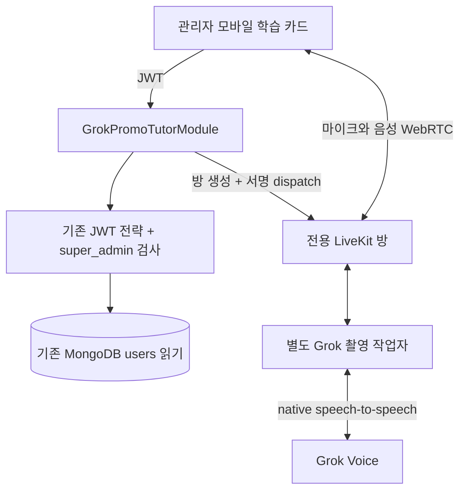

# 관리자 전용 Grok 촬영 튜터

`super_admin`만 사용할 수 있는 별도 음성 대화. 일반 `/voice-tutor`의 설정, 목소리,
기억, 수업 기록, 쿼터, 진도와 연결하지 않는다. DB 컬렉션이나 스키마를 추가하지 않는다.

앱 학습 카드 → `/grok-promo-tutor/sessions` → 별도 LiveKit 방/워커 → Grok native
speech-to-speech. OpenAI, ElevenLabs는 이 통화에서 사용하지 않는다.

| 구성 | 선택 | 이유 |
| --- | --- | --- |
| API | 기존 NestJS의 별도 모듈 | 일반 튜터 의존성과 저장 로직을 분리 |
| 인증 | 기존 JWT + 최고 관리자 guard | 기존 로그인 응답이나 DB 변경 없이 권한 확인 |
| 통화 | 기존 LiveKit + 별도 Node 작업자 | 모바일 네이티브 의존성 재사용, 일반 작업자와 분리 |
| AI | Grok native voice | 받아쓰기·응답·발화를 한 공급자에서 처리 |
| 배포 | 별도 opt-in Compose 서비스 | 기존 배포 흐름에서 촬영 작업자를 자동으로 시작하지 않음 |

새 DB 스키마는 없다. 기존 `users`의 `_id`, `adminRole`을 인증 시 읽고,
임시 방 소유권 `{kind, ownerId, sessionId}`는 서버가 LiveKit room metadata에 기록한다.

- `GET /grok-promo-tutor/options`: 인증/최고 관리자 확인 후 사용 가능 여부 반환.
  일반 계정은 403이므로 학습 카드도 표시하지 않는다. 기존 로그인 응답은 바꾸지 않는다.
- `POST /grok-promo-tutor/sessions`: 대본/음성 텍스트를 받지 않고, 새 UUID와 최대
  10분짜리 마이크 전용 LiveKit 참가 권한을 발급한다. 생성 실패 시 방을 정리한다.
- `POST /grok-promo-tutor/sessions/:id/end`: 서버가 기록한 방 소유자와 세션 ID를
  확인한 후 방을 닫는다. API 재시작/blue-green 전환 후에도 종료할 수 있다.

모든 경로는 JWT와 `GrokPromoAdminGuard`로 보호한다. 작업자 dispatch metadata는
LiveKit secret으로 HMAC 서명한다. API와 작업자의 필드 순서가 같아야 한다.
실제 종료는 별도 워커가 시간 초과, 소유자 이탈, 공급자 오류에서도 강제한다.

## 성격과 참고 영상

`grok-promo-persona.ts`는 사용자가 제공한 여섯 샘플의 전사와 화면 자막에서 추린
행동 지침이다. 짧은 질문, 실제 답에 대한 과장된 놀람, 영어/한국어 전환,
독한 욕설과 놀림, 정확한 교정, 재도전 후 웃음과 능청스러운 인정이 핵심이다.
성인 소유자는 센 욕과 독한 놀림을 명시적으로 요청했다.

고정 대사, 예상 학습자 답변, 턴 번호별 반응표를 넣지 않는다. 질문과 농담은
Grok이 실시간으로 생성한다. 샘플 원본, 음성, 전체 전사, API 키는 저장소에 넣지 않는다.
같은 질문에 매번 같은 리액션을 보장하는 기능이 아니다. 새 모델의 목소리와 연기
품질은 실제 기기에서 소유자가 확인해야 한다.

## 활성화

기본은 꺼짐. API에는 `GROK_PROMO_TUTOR_ENABLED=true`와 기존 LiveKit 설정,
별도 워커에는 같은 LiveKit 프로젝트 정보와 `XAI_API_KEY`가 필요하다.
`options.available`은 운영자가 활성화한 설정 여부이며 공급자 결제/실시간 가용성
확인이 아니다. 작업자를 먼저 시작하고 API 플래그를 켠다.

별도 워커 실행/배포는 `apps/tutor-agent/README.md`,
`deploy/grok-promo-agent.env.example`, `deploy/README.md` 참고.
기존 일반 튜터의 배포 명령과 환경변수는 그대로 둔다.

검증: `pnpm --filter api exec jest --runInBand --testPathPatterns grok-promo-tutor`.
